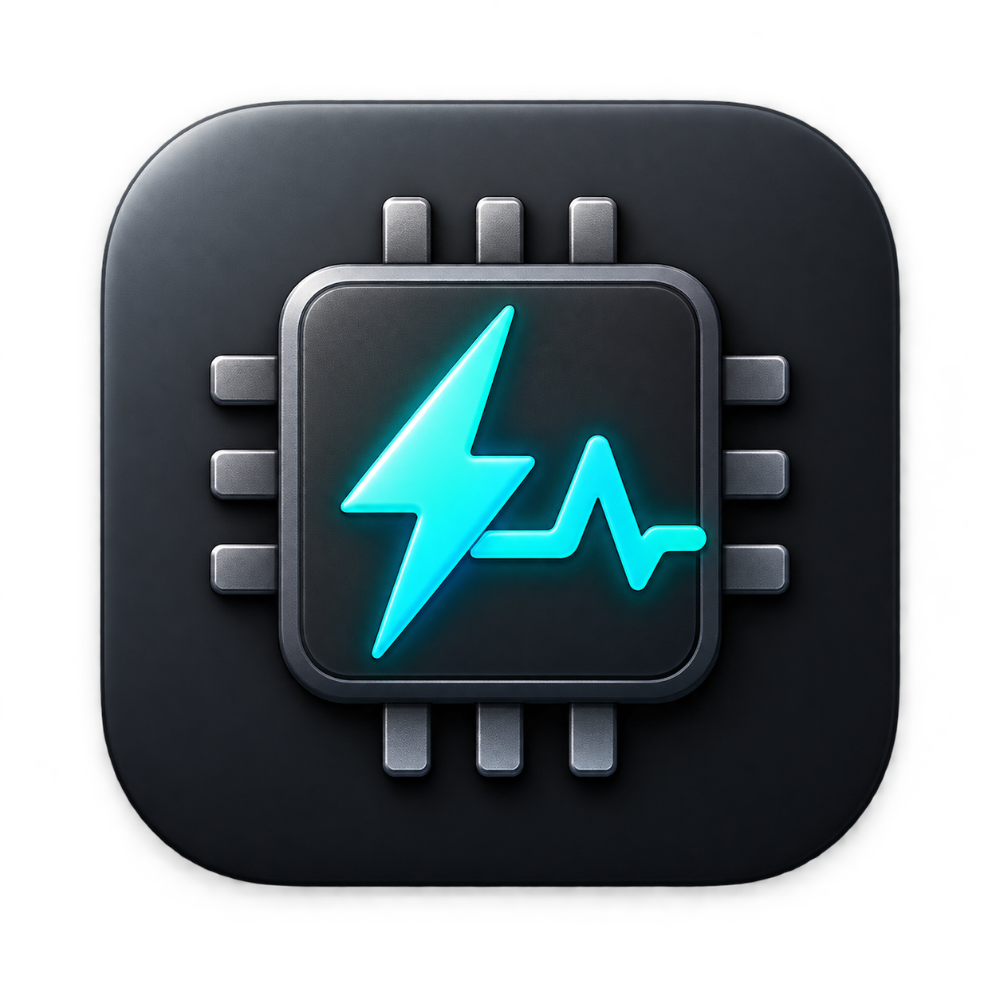

<div align="center">
  

  # ChipBar

  **让 Apple Silicon 的功率、温度和应用资源占用，一眼可见。**

  原生 macOS 菜单栏监控工具 · 紧凑 Liquid Glass 面板 · 无需为基础功率监控授予管理员权限

  [](https://github.com/wwwwzzzzkkkk/macmon/releases/tag/chipbar-v1.3.16)
  
  

  **[下载最新版](https://github.com/wwwwzzzzkkkk/macmon/releases/tag/chipbar-v1.3.16)** · **[功能与使用手册](apps/ChipBar/README.md)** · **[问题反馈](https://github.com/wwwwzzzzkkkk/macmon/issues)**
</div>

---

## 产品预览

<div align="center">
  
  <p><sub>监控面板 · 仓库中保存的应用实际截图，样式与数值可能因安装版本、设备而不同</sub></p>
  
  <p><sub>浅色模式与设置页 · 现有截图素材；新版设置页采用二级页面布局</sub></p>
</div>

## 一块面板，查看重要的 Mac 指标

| 功能 | 可以查看什么 |
| --- | --- |
| ⚡ **芯片功率** | CPU / GPU / ANE 分项功率和合计功率（W），以及最近 10 分钟趋势 |
| ◉ **圆环仪表** | CPU、GPU 活跃时间占比和系统内存使用率；圆环与数字同步弹簧过渡 |
| 🧩 **应用资源排行** | 逐应用 CPU、GPU、**物理内存占用**、ANE 内存，自动合并可识别的辅助进程；支持前三名 / 前五名 |
| 🌡️ **状态与温度** | CPU / GPU 温度、风扇 RPM、系统内存已用量及内存压力等级 |
| ⇅ **实时传输速率** | 菜单栏显示网络上下行、磁盘读写、外接磁盘读写速率 |
| 💽 **外接 NVMe SSD** | 可选 SSD 型号、综合温度、SMART 状态、可用空间及整盘实时 I/O 速度 |
| ✨ **原生 macOS 体验** | 370 pt 紧凑面板、macOS 26+ 原生 Liquid Glass、旧系统磨砂材质、深浅模式与减少动态效果适配 |

> **功率定义：**“芯片合计”是 CPU + GPU + ANE 的芯片功率读数，**不是整台 Mac 从插座获取的电功率**。应用 GPU 百分比来自驱动时间统计；应用 ANE 项是记账内存，不是神经网络引擎的运算利用率。硬件和系统不支持的数据会标记为不可用。

## 安装

**方式一：下载应用**（Apple Silicon，macOS 13 或更高）

前往 **[ChipBar 最新正式版本](https://github.com/wwwwzzzzkkkk/macmon/releases/tag/chipbar-v1.3.16)**，下载 `ChipBar-macOS-arm64.zip`，解压后将 `ChipBar.app` 拖到“应用程序”，退出旧版后启动新版。ChipBar 使用独立安装的 [macmon](https://github.com/vladkens/macmon) 采集芯片指标。

**方式二：Homebrew（推荐，自动安装 macmon 依赖）**

```bash
brew tap --custom-remote wwwwzzzzkkkk/chipbar https://github.com/wwwwzzzzkkkk/macmon.git
brew install --cask wwwwzzzzkkkk/chipbar/chipbar
open -a ChipBar
```

更新：

```bash
brew update
brew upgrade --cask wwwwzzzzkkkk/chipbar/chipbar
```

> 安装包采用本地 ad-hoc 签名，**尚未 Apple 公证**。如系统拦截，请确认来源可信后到“系统设置 → 隐私与安全性”按提示允许打开。SSD 温度需要可选的 `smartmontools` 与硬盘盒 SMART 透传支持；基础功率监控无需 sudo。

## 你可能关心的细节

- **菜单栏可以自己选**：功率、CPU/GPU 活跃度、内存、CPU 温度、风扇、网络和磁盘速率都可以自由开关；保持原来的双排紧凑排版。
- **应用内存不是仅看主进程**：按可识别的应用进程及其辅助进程汇总 Physical Footprint，必要时使用带 `≈` 标记的 RSS 近似值；可能与活动监视器逐行读数或“App 内存”系统分类不同。
- **只做本机监控**：偏好设置在本机，趋势数据只存在内存里；没有跨 Mac 远程汇总功能。采样故障会重试，睡眠/暂停时按状态停止采集。
- **性能友好的展示**：菜单栏同步刷新，面板关闭时不绘制趋势；SSD 和应用级采样分别采用有界的读取周期。

## 项目与源码

**ChipBar** 是 `macmon` 仓库的 **`chipbar` 分支**下的原生 SwiftUI / AppKit 客户端，代码在 **[`apps/ChipBar/`](apps/ChipBar/)**；Rust `macmon` 的上游主线位于独立的 `main` 分支。芯片指标依赖 [vladkens/macmon](https://github.com/vladkens/macmon)，感谢原作者与贡献者。

**[完整功能、指标口径与安装说明](apps/ChipBar/README.md)** · **[源码目录](apps/ChipBar/Sources/)** · **[SSD 兼容说明](apps/ChipBar/docs/EXTERNAL_SSD.md)** · **[更新记录](apps/ChipBar/CHANGELOG.md)** · **[发布页面](https://github.com/wwwwzzzzkkkk/macmon/releases)**

<details>
<summary>English summary</summary>

**ChipBar** is a compact native Apple Silicon menu-bar monitor for macOS 13+. It displays CPU/GPU/ANE power, temperatures, utilization gauges, recent power trends, per-application CPU/GPU/memory activity, network/disk throughput, and optional external NVMe SSD telemetry. Powered by an independently installed `macmon` executable, with SwiftUI and AppKit presentation. ChipBar's development branch is `chipbar`, with its Swift source under `apps/ChipBar/`. Not Apple-notarized; readings depend on hardware and macOS support.

</details>
