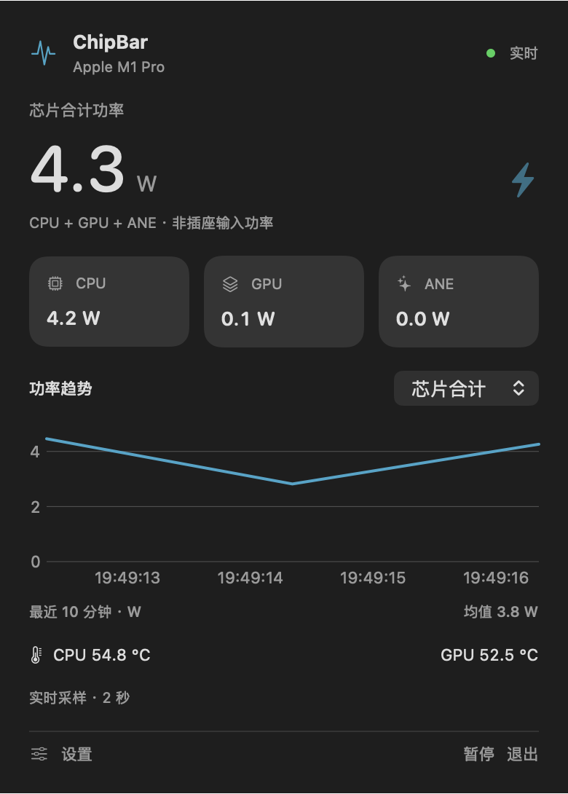
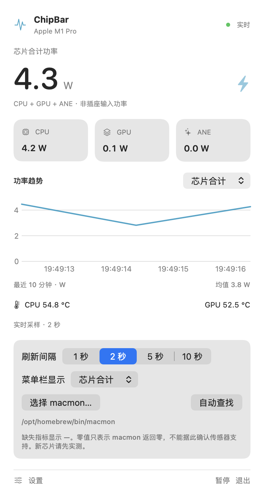

# ChipBar · Apple Silicon 菜单栏监控

> **ChipBar v1.3.17** · macOS 13+ · Apple Silicon（arm64） · SwiftUI + AppKit  
> 在一个 370 pt 的原生菜单栏面板中，查看功率、温度、CPU/GPU 活跃度、系统内存、应用排行和可选的外置 SSD 状态。

**[返回产品主页](../../README.md)** · **[下载正式版](https://github.com/wwwwzzzzkkkk/macmon/releases/tag/chipbar-v1.3.17)** · **[更新记录](CHANGELOG.md)** · **[反馈问题](https://github.com/wwwwzzzzkkkk/macmon/issues)**

## 产品截图

<div align="center">
  
  <p><sub>菜单栏监控面板 · 仓库保存的原生截图；不同版本及设备的显示内容可能不同</sub></p>
  
  <p><sub>浅色模式与设置截图 · 当前版本已采用独立设置二级页</sub></p>
</div>

## 为什么使用 ChipBar？

ChipBar 专为希望**在工作时随时了解 Mac 资源状态**的用户设计。不需要反复打开活动监视器或终端，就能从菜单栏看到芯片功率、处理器活跃度、风扇速度或传输速率；点击菜单栏，则可以展开更详细的原生监控面板。

它适合日常办公、视频剪辑、程序编译、本地模型推理、外接 NVMe SSD 长时间读写等场景。它是本机状态观察工具，不提供远程设备汇总、数据同步或电池/插座用电计量。

## 功能详解

### 1. 实时芯片功率

| 信息 | 内容 |
| --- | --- |
| **芯片合计** | CPU、GPU 和 ANE 功率之和，单位 W |
| **CPU / GPU / ANE** | 三项独立功率卡片，支持有效的 0 W 和缺失值显示 |
| **最近 10 分钟趋势** | 选择芯片合计、CPU、GPU 或 ANE 查看功率折线及时间段平均值 |
| **设备信息** | 显示硬件 / 芯片名称、连接与暂停状态 |

这里的芯片合计功率**不是整机从交流插座获得的功率**，也不等同于电脑的总能耗。芯片传感器的可用性由设备、macOS 和已安装的 macmon 决定。

### 2. 圆环利用率、内存与温度

- **CPU 活跃度 / GPU 活跃度**：各以 0–100% 的圆环呈现，数字与弧线同步动画；不把功率 W 当作百分比。
- **系统 RAM**：内存使用率圆环、已用容量 / 总容量和内存压力（正常、偏高等）；圆环数值不同于应用级内存排行。
- **CPU / GPU 温度**：显示 macmon 能提供的温度，无法读取时明确标为不可用。
- **风扇转速**：显示有效的 RPM，多个风扇的值按实际读数展示。

数值刷新时使用柔和的弹簧过渡；系统开启“减少动态效果”时减少相应动画。功率历史最多保留约 10 分钟，退出即清空。

### 内置储存可用空间

主面板新增「内置储存」卡片，显示 Mac mini 或其他 Apple Silicon Mac **内置启动盘**的可用容量、已使用容量和总容量，并使用一条简洁的空间占用进度条。

- 通过系统 `DiskArbitration` 确认磁盘为**内置设备**，并从 macOS 的 APFS Data 数据卷读取当前用户可用的文件系统空间；必要时回退到启动卷。不把外接硬盘或网络磁盘冒充为内置空间。
- **只读取一份卷容量**，不会把同一 APFS 容器内的 System、Data 和其他共享卷重复累加。显示值是卷容量与当前可用空间，并非 NAND 闪存原始容量、剩余寿命或所有储存设备容量之和。
- 大约每 30 秒重新读取一次；不安装辅助程序、不调用管理员权限、不运行 SMART 命令。无法可靠确认内置启动磁盘时显示「不可用」，不会填入虚假数值。
- 卡片始终保持相同高度，避免首次读取造成玻璃面板突然变化；单位按照 macOS 十进制磁盘容量格式显示。

### 3. 「应用占用」：CPU / GPU / 内存 / ANE

打开面板默认显示资源排行**前三名**，点击“更多”可查看**前五名**，无需额外打开其他窗口。四项可以随时切换：

| 选项 | 指标含义 | 需要了解 |
| --- | --- | --- |
| **CPU** | 逐进程 CPU 时间差与采样间隔计算出的占比 | 一个逻辑核心约为 100%，多核应用可能超过 100% |
| **GPU** | AGX 驱动暴露的逐进程 GPU 时间占比 | 可能超过 100%，不是将整机 GPU 占用率按应用分摊 |
| **内存** | 逐进程 Physical Footprint（物理内存足迹）按应用合并，自动显示 MB/GB | 无法读取足迹时可用 RSS 近似，带 `≈`；与活动监视器的系统“App 内存”分类不相同 |
| **ANE** | 系统记账的应用级 ANE 内存 | **不是 ANE 运算利用率**，系统没有提供时显示不可用 |

按可识别的应用包和辅助进程分组汇总；独立进程或不能可靠确定所属应用的服务可能单独列出。同一应用涉及多个 Renderer / Helper 时，其总数可能明显大于活动监视器里单独的主进程。

应用资源采样仅在面板需要时进行，至少间隔约 2 秒；面板短时间内重新打开会复用最多 10 秒的最近读数，不保存历史。

**实际使用验证：** 在 Apple M5 Pro 的诊断构建中，Google Chrome 和 ChatGPT 的应用内存已读取出 GB 级汇总值，并与活动监视器分层查看的相关子进程数量级基本吻合。两者采样时间及进程归属口径不同，不应期望逐字节一致。

### 4. 菜单栏自定义

菜单栏保留紧凑的双行排版，可在**设置 → 菜单栏项目**中自由选择需要常驻显示的项目：

- Logo、芯片功率、CPU / GPU 利用率、系统内存、CPU 温度与风扇 RPM。
- 网络上传 / 下载速率；内置与外接磁盘合计的读取 / 写入速率，以及外接磁盘单独的读写速率。
- 可选的外置 SSD 温度读数。

菜单栏数值按选定采样节奏同步刷新，尽量减少数字宽度变化导致的位置跳动。展开面板为了保持简洁**不重复展示网络速率**，这些指标仍可单独保留在菜单栏。

### 5. 外接 NVMe SSD

SSD 监控是**可选功能**，用户开启后可在面板中查看：

- 外接物理磁盘型号、当前温度（°C）、可用空间 / 总空间。
- 磁盘真实读取 / 写入速率（MB/s），与接口标称带宽不同。
- 展开“详情”查看温度传感器、SMART 状态及不同卷的可用空间。
- 多块 SSD 的发现与离线状态；SMART 读数过期或无透传时不会伪造温度。

磁盘速度和空间使用 macOS 本机接口，可不依赖 `smartctl`；**SMART / 温度**需额外安装 `smartmontools`，并要求 SSD 与硬盘盒支持透传。温度通常约每 30 秒按轮读取，实时读写速度在面板可见时才持续采样。详见 **[SSD 安装、权限和兼容说明](docs/EXTERNAL_SSD.md)**。

### 6. Liquid Glass 与交互细节

- macOS 26+ 使用系统 `NSGlassEffectView`；较早版本使用 `NSVisualEffectView`，并适配深色 / 浅色模式。
- **370 pt 紧凑宽度**；窗口依屏幕可用空间调整高度，内容多时支持滚动。
- 进入“设置 ›”后切换到**独立二级页面**，左上角“‹ 返回”回到监控面板。
- 页面切换采用淡入 + 方向滑动，面板高度收缩 / 展开使用柔和弹簧式缓动。
- 支持显示 / 隐藏、暂停 / 恢复；点击其他地方或按 Esc 关闭面板。

## 安装和更新

### Homebrew（推荐）

需要 Apple Silicon Mac、macOS 13+、Homebrew。

```bash
brew tap --custom-remote wwwwzzzzkkkk/chipbar https://github.com/wwwwzzzzkkkk/macmon.git
brew install --cask wwwwzzzzkkkk/chipbar/chipbar
open -a ChipBar
```

ChipBar 的 Cask 依赖独立的 `macmon` formula；Homebrew 会处理该依赖。

```bash
brew update
brew upgrade --cask wwwwzzzzkkkk/chipbar/chipbar
```

### 手动下载安装包

从 **[GitHub Releases](https://github.com/wwwwzzzzkkkk/macmon/releases)** 下载最新的 `ChipBar-macOS-arm64.zip`，解压后将 `ChipBar.app` 放进应用程序文件夹。**请先彻底退出旧版再启动新版本**。手动下载需要自行安装受支持的 macmon 可执行程序，并确保 ChipBar 能自动发现。

本项目的二进制使用 ad-hoc 本地签名，**没有 Developer ID 签名或 Apple 公证**；如 macOS 提示阻止打开，应先确认下载来源，再依系统提示在“隐私与安全性”允许打开。

### 首次使用

1. 启动后点击菜单栏中的 ChipBar 读数。
2. 查看芯片合计、CPU/GPU/ANE、利用率、内存和温度。
3. 点击“应用占用”中的 CPU、GPU、内存或 ANE 切换排行；“更多”查看前五名。
4. 在“设置”选择 1 / 2 / 5 / 10 秒硬件刷新间隔及常驻菜单栏项目。
5. 如果使用外置 NVMe SSD，可开启相应监控；温度功能按需安装 `smartmontools`。

## 技术原理与隐私

ChipBar 是 Apple Silicon 的 SwiftUI / AppKit 原生客户端，使用独立运行的 [macmon](https://github.com/vladkens/macmon) 通过 JSON 流获得主要硬件指标。应用、磁盘、网络的相关数据由 macOS 本地接口读取。

- **基础功率读取**不需要管理员权限，不安装常驻 root 服务，也不需要开启 HTTP 服务器。
- **SMART 权限**取决于实际硬盘与 macOS；对已有非交互授权仅按用户已保存的兼容配置使用，不会静默授予权限。
- **偏好设置保存在本机**；趋势和应用排行不上传服务器，不保存跨次启动的监控历史。
- 面板关闭后会停止不必要的重绘及部分采样；睡眠、暂停及退出时依不同数据源处理采样生命周期。
- 程序不能代替专业电力测量仪器、完整的 Activity Monitor 或设备硬件诊断软件。

## 开发者指南

代码位于 `apps/ChipBar`，与仓库中 Rust macmon 的 `main` 分支分别维护。建议使用 Xcode 或相应 Apple Command Line Tools / Swift 环境。

```bash
git clone --branch chipbar https://github.com/wwwwzzzzkkkk/macmon.git
cd macmon/apps/ChipBar

./scripts/test.sh
./scripts/build.sh
open dist/ChipBar.app
```

独立执行构建脚本会生成 arm64 的 `.app`。实际 CI 还会执行打包、签名校验、故障检查与 Homebrew Cask 更新。详见 **[验证记录](VALIDATION.md)**、**[变更历史](CHANGELOG.md)**、**[开发协作约定](AGENTS.md)**。

### 源码模块

| 文件 | 职责 |
| --- | --- |
| `Sources/ChipBar/App.swift` | App 入口、诊断命令、截图与 UI 测试入口 |
| `Sources/ChipBar/Monitor.swift` / `StreamClient.swift` | macmon 流、状态、过期检测与重试 |
| `Sources/ChipBar/Dashboard.swift` / `MenuController.swift` | 菜单栏、原生玻璃面板与设置导航 |
| `Sources/ChipBar/MetricRing.swift` / `PowerTrendPlot.swift` | 动画利用率圆环与功率趋势 |
| `Sources/ChipBar/ApplicationActivitySampler.swift` / `ApplicationUsageSection.swift` | CPU、GPU、物理内存与 ANE 的逐应用排行 |
| `Sources/ChipBar/SSDSection.swift` / `ExternalSSDMonitor.swift` | 外接 NVMe SSD 展示、检测与温度 |
| `Sources/ChipBarCore/` | 指标解析、数据格式化、进程分组和辅助工具 |

### 本机数据诊断

```bash
# 真实芯片数据采样
dist/ChipBar.app/Contents/MacOS/ChipBar --diagnose

# 应用 CPU/GPU/内存/ANE 进程数据（JSON）
dist/ChipBar.app/Contents/MacOS/ChipBar --diagnose-apps

# 可选 SSD 只读诊断
dist/ChipBar.app/Contents/MacOS/ChipBar --diagnose-ssd
```

`--diagnose-apps` 输出每个应用的原始内存字节数、显示值、是否使用 RSS 近似、分组进程数量，便于与活动监视器逐项核对。请注意诊断文本可能包含当前运行应用的名称，分享前请自行审阅。

## 致谢

ChipBar 建立在 [vladkens/macmon](https://github.com/vladkens/macmon) 的实时 Apple Silicon 指标采样能力之上。感谢上游作者与开源贡献者。ChipBar 原生菜单栏界面、应用分组和 SSD 展示维护于本仓库的 `chipbar` 分支。
