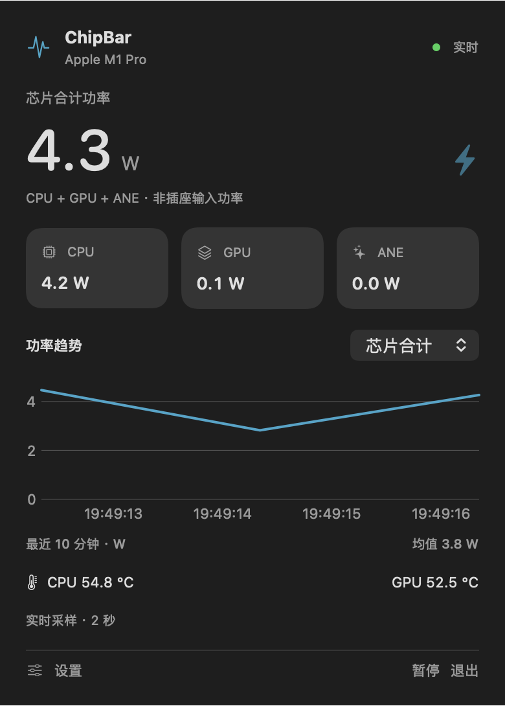
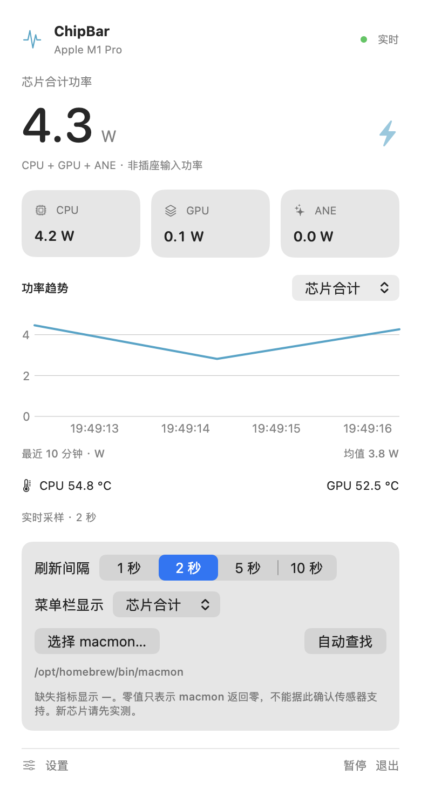

# ChipBar v3.3.0 · Apple Silicon 菜单栏监控

> macOS 13+ · Apple Silicon (arm64) · 原生 SwiftUI + AppKit · macOS 26+ Liquid Glass
>
> 最新界面采用三个独立圆环磁贴、紧凑的 CPU 各核心图、风扇与 ANE 并排布局，以及“电源与功率 / 应用占用 / 外置硬盘”独立二级卡片。

**[GitHub 产品主页](../../readme.md)** · **[下载 v3.3.0](https://github.com/wwwwzzzzkkkk/macmon/releases/tag/chipbar-v3.3.0)** · **[更新记录](CHANGELOG.md)** · **[反馈问题](https://github.com/wwwwzzzzkkkk/macmon/issues)**

## v3.3.0 新功能：自由排列与系统小组件

主页所有十个磁贴均可重排。长按任意磁贴约 0.45 秒，或点击页头「排列」，进入编辑模式：当前磁贴抬起高亮；拖动时邻近磁贴平滑避让，松手后有压缩回弹的落位动画。可拖至底部专用落点放在最后，点击「完成」退出。位置和磁贴显示开关自动保存；设置页面的「主页磁贴布局」可恢复默认并按模块隐藏／显示。

**macOS 原生 WidgetKit：** 将 ChipBar 安装到“应用程序”后，在桌面点右键选择「编辑小组件」并搜索 **ChipBar**，或进入通知中心的「编辑小组件」，分别选择「芯片功率趋势 / CPU / GPU / 内存 / CPU 各核心 / 风扇 / ANE / 储存空间 / 内部功率 / 应用占用」。每种模块均提供小、中、大三种系统尺寸。桌面小组件要求 macOS 14 或以上；通知中心小组件支持 macOS 13 或以上。

系统小组件显示**最近一次监测快照，而非 1～3 秒实时视图**：主应用最多每分钟共享一次只读数据，WidgetKit 通常以更低频率刷新，具体取决于系统调度；长时间没有有效更新时会明确显示过期状态。直接打开 ChipBar 菜单可查看实时功率与曲线。

发布包新增内嵌 `ChipBarWidgets.appex`；macOS 13～25 保留原有材质降级策略。构建/发布需要检查扩展签名及安装包完整性。首次安装后如系统未即时发现小组件，可以重新打开小组件选择器。

## 界面与导航 · v3.3.0

### 1. 主监控面板（约 378 pt 宽）

| 布局 | 内容 |
| --- | --- |
| **页头与功率趋势** | 芯片型号／当前连接状态、CPU / GPU / ANE 功率磁贴、芯片总功率及最近约十分钟的趋势图；支持切换趋势指标 |
| **三张独立圆环磁贴** | 蓝色 CPU 活跃度、紫色 GPU 活跃度、薄荷青绿内存占用；各卡分别展示百分比及功率、温度或已用／总内存 |
| **CPU 各核心负载** | 横向分布的逐逻辑核心柱状图；核心类型可靠识别时，在标题旁使用颜色圆点与各类型数量的图例，不逐柱重复“性／超”等标记 |
| **风扇 + ANE** | 风扇转速与 ANE 功率分占同一行两个等宽磁贴 |
| **存储空间** | 内置 Macintosh HD 容量卡片；每个已连接外置磁盘各自显示容量、读写速率并可点击进入自己的详情 |
| **快捷入口** | “电源”入口直接显示内部功率，并打开“电源与功率”桑基图侧卡；“应用占用”入口打开进程排行侧边卡片 |
| **自定义磁贴** | 十个模块可长按拖动、弹性避让与落位，排列与隐藏状态持久保存 |

三个环形数值不是功率百分比：CPU / GPU 使用活跃度，内存使用已用容量比例。内存环颜色反映系统内存压力，**不是**“内存使用率达到某个固定百分比就变红”。测不到的硬件数据会显示为不可用。

### 2. 「电源与功率」桑基图侧卡（v3.3.0）

首页已经显示 CPU、GPU、ANE 功率与历史曲线，这里**不重复**。二级页采用约 420 pt 宽的独立玻璃侧卡，保留顶部返回按钮、传感器在线状态、实时胶囊，下面仅保留一张 **“功率流向”** 磁贴，已移除最下方的文字说明。

- **桑基图：** 190 pt 高的 SwiftUI Canvas，左侧内部功率按实际瓦数流向右侧芯片、其余部件两个节点。流带使用三次贝塞尔曲线与琥珀／高对比度中性色渐变；芯片流带带 8 pt 琥珀色柔光。
- **比例与布局：** 每瓦 4.4 pt，高度最多 150 pt；右侧两个节点间隔 16 pt。侧卡内部绘图区域约 372 pt，其他二级卡片仍采用原来的紧凑宽度。
- **动画：** SMC 电源传感器约每 3 秒更新一次，流带高度与功率／占比数字以约 0.7 秒平滑过渡；数值标签固定位置，避免上下跳动。两条流带的圆头虚线以约 1.1 秒为周期流动，减少动态效果、采样暂停或面板关闭时不持续刷新。
- **实时标签：** 内部系统功率、芯片功率、其余部件估算功率与各自占比。MacBook 电池供电时来源文字会随实际状态变化；Mac mini 不会凭空显示插座 AC 功率。
- **读数边界：** 内部 DC 功率**不是**插座 AC 输入功耗；“其余部件”由内部功率减去芯片总功率**估算**，无效读数不绘制虚构流带。底部数据源说明磁贴已移除，但原有 SMC 传感器采样方式保持不变。

支持 VoiceOver 一次朗读内部功率、芯片功率和其余部件估算功率。图中没有独立的功率构成进度条，也不含重复的 CPU/GPU 曲线。

### 3. 「应用占用」独立卡片

点击首页入口后，在独立玻璃侧边卡片中选择四种指标，默认展示最多五个应用。页面移除了面向开发者的长段采样说明和无意义的固定高度留白。

| 指标 | 口径 |
| --- | --- |
| **CPU** | 通过逐进程 CPU 时间差计算；一个逻辑核心约为 100%，多核应用可能超过 100% |
| **GPU** | 驱动公开的逐进程 GPU 时间统计，**不是**把全机 GPU 百分比按应用分摊 |
| **内存** | 优先使用进程 Physical Footprint，并尽可能合并同一应用辅助进程；读取不可用时采用明确标注的 RSS 近似 |
| **ANE** | 系统公开的应用级 ANE 内存记账，**不是**神经网络引擎算力利用率 |

应用名称与图标来自系统可识别的进程关系；有些独立服务可能无法归属到某个应用包。短时间重开会复用近期结果；只在需要时进行应用采样，避免菜单栏长期运行时不必要的负担。

### 4. 「外置硬盘」独立卡片

首页**只有检测到实际挂载的外置卷**才显示对应容量磁贴。每个磁盘的磁贴可以单独点击；内置 Macintosh HD 仍为只读容量展示，不会进入外置盘页。

外置磁盘详情沿用现有玻璃磁贴设计，包括：

- 卷名、SMART 能识别的 SSD 型号、已用百分比、醒目的可用容量、总容量和 8 pt 占用进度条。
- 温度、读取、写入三个等宽小磁贴。读写速率与首页**共享同一套磁盘采样数据**，不是单独估算的另一组数字。
- **“在菜单栏显示”**原生开关，针对当前外接物理磁盘保存温度显示偏好。多盘各自拥有独立详情与选择；当前磁盘断开后对应入口会消失。

空间与磁盘速率由 macOS 原生 API 读取，不需要 SMART。**温度与型号是否可用，取决于 `smartmontools`、硬盘接口及桥接芯片是否透传**；无法读取时显示“—”。Zark、ZHITAI 和其他磁盘型号仅是可能的实际设备读数，应用不会硬编码特定品牌、容量、温度或速度。设备重新连接后物理盘编号有可能变化，此时可能需要重新检查该盘的菜单栏温度偏好。

### 5. 「设备与设置」页面

设置仍采用原有紧凑磁贴风格，包含：

- **设备信息：** 芯片与机型，2 × 2 硬件概览（系统版本、统一内存、CPU 核心及核类型），下方只保留风扇转速状态。
- **采样频率：** 1 / 2 / 5 / 10 秒可选，对 macmon 芯片等指标生效；独立 SMC 电源传感器固定约 3 秒以降低开销。选项采用可平滑滑动的 Liquid Glass 水滴胶囊。
- **菜单栏显示：** 三列共 **8 个**项目：图标、功率、CPU/GPU 活跃度、内存、CPU 温度、风扇、网络、磁盘速率；最后一项跨两列。菜单栏功率指标也使用滑动玻璃分段选项。应用占用的 CPU / GPU / 内存 / ANE 指标切换共享相同动效。
- **SSD 温度总开关：** 始终可操作，**即使没有连接任何外置盘**，也可以关闭菜单栏 SSD 温度。关闭总开关不会清空单块磁盘已保存的偏好。
- **更新检查：** 显示当前版本与应用更新状态，可按界面提示检查新版。

外置磁盘的详细状态与逐盘开关已经移至自己的磁盘二级页，设置里不再重复一块大型 SSD 详情卡片。

### 截图说明

现有仓库保留 `preview.png` 和 `preview-settings.png` 两张历史截图，但它们展示的是**较早版本**，不应当视为 v3.3.0 的真实界面截图。为避免误导，新版 UI 的结构以以上说明和源码为准；可在本机重新截取 v3.3.0 实际界面后替换图片。

<details>
<summary>展开旧版界面参考图</summary>

<p align="center">
  
  <br />
  <sub>历史主面板截图，并非 v3.3.0。</sub>
</p>

<p align="center">
  
  <br />
  <sub>历史设置页截图，并非 v3.3.0。</sub>
</p>
</details>

## 安装与更新

**系统要求：** Apple Silicon Mac、macOS 13 或以上；基础芯片数据由独立的 [macmon](https://github.com/vladkens/macmon) 提供。部分传感器在不同 Mac 芯片和 macOS 版本上可能不可用。

### Homebrew（推荐）

```bash
brew tap --custom-remote wwwwzzzzkkkk/chipbar https://github.com/wwwwzzzzkkkk/macmon.git
brew install --cask wwwwzzzzkkkk/chipbar/chipbar
open -a ChipBar
```

该 Cask 会声明独立的 macmon 依赖。更新：

```bash
brew update
brew upgrade --cask wwwwzzzzkkkk/chipbar/chipbar
```

### 手动安装

1. 打开 **[v3.3.0 正式发布页](https://github.com/wwwwzzzzkkkk/macmon/releases/tag/chipbar-v3.3.0)**，下载 `ChipBar-macOS-arm64.zip`（发布页同时提供 `SHA256SUMS`）。
2. 退出正在运行的旧 ChipBar。
3. 解压后将 `ChipBar.app` 移入「应用程序」，启动新版。手动安装请另行确保 macmon 可用。

发布包采用**本地 ad-hoc 签名，并未经过 Apple Developer ID 公证**。如 macOS 阻止打开，请核对下载来源与校验值后依系统提示允许。ChipBar 不为基础功率监控安装常驻 root 服务。

### 首次使用

1. 点击菜单栏中的 ChipBar 指标打开主页。
2. 查看功率、三个独立圆环、逐核心负载以及风扇／ANE。
3. 点击「电源与功率」或「应用占用」查看对应侧边页；已挂载外置盘还可点击各自的容量卡片。
4. 打开「设备与设置」选择菜单栏指标和采样间隔；即使没有外置盘，也可关闭 SSD 温度总开关。
5. 需要 SSD 温度时安装 `smartmontools`，并核对硬盘与硬盘盒 SMART 兼容性，详见 **[外接 NVMe SSD 指南](docs/EXTERNAL_SSD.md)**。

## 指标边界、隐私与性能

- **芯片功率**和**内部系统功率**是不同读数。macmon 提供芯片指标，设备内部供电使用可用的 AppleSMC 传感器；这两者都不能替代墙插电表。
- **网络与磁盘速度**是采样周期内的传输速率，单位 MB/s 等。首次采样建立计数器基线；没有足够数据时不会把“未知”伪装成 0。
- **内存**既展示已用容量，也用状态色传达系统内存压力。应用级内存统计并不完全等同于活动监视器的整机内存分类。
- **按需采样：** 主面板隐藏、睡眠或暂停时，部分高成本视图和采样会停止或降低频率；SSD 温度探测有独立周期，具体见 [SSD 指南](docs/EXTERNAL_SSD.md)。
- **本地隐私：** 趋势数据与应用排行留在本机，常规运行不向云端上传监控历史，也不提供远程设备管理。

## 技术实现与开发

ChipBar 代码位于本仓库 `chipbar` 分支的 `apps/ChipBar` 目录中。Rust macmon 上游主体仍保存在独立的 `main` 分支。客户端通过 SwiftUI 组合磁贴、图表、页面，借助 AppKit 管理菜单栏和原生侧边 `NSPanel`，并使用 macOS 本机接口读取外置卷信息。

```bash
git clone --branch chipbar https://github.com/wwwwzzzzkkkk/macmon.git
cd macmon/apps/ChipBar

./scripts/test.sh
./scripts/build.sh
open dist/ChipBar.app
```

| 源码模块 | 职责 |
| --- | --- |
| `Dashboard.swift` / `RingDashboard.swift` / `CPUCoreUsageSection.swift` | 主界面、三圆环磁贴及逐核心图例 |
| `SidePanelView.swift` / `SidePanelController.swift` | 独立玻璃侧边页与窗口尺寸、导航 |
| `PowerSupplyDetailView.swift` / `PowerFlowSampler.swift` | Mac mini / MacBook 供电拓扑、内部功率测量与估算构成 |
| `ApplicationActivitySampler.swift` / `ApplicationUsageSection.swift` | 逐应用 CPU / GPU / 内存 / ANE 排行 |
| `StorageCapacitySection.swift` / `ExternalDiskDetailView.swift` | 内外置容量卡片、卷级导航与磁盘详情 |
| `ExternalSSDMonitor.swift` / `SSDSection.swift` | 可选 SMART 温度、菜单栏温度偏好及探测逻辑 |
| `Monitor.swift` / `MenuController.swift` | macmon 流、更新周期、菜单栏、玻璃窗口生命周期 |

### 本机诊断

```bash
dist/ChipBar.app/Contents/MacOS/ChipBar --diagnose
dist/ChipBar.app/Contents/MacOS/ChipBar --diagnose-apps
dist/ChipBar.app/Contents/MacOS/ChipBar --diagnose-ssd
```

诊断输出可能包含运行中的应用名称和本机设备信息，分享前请自行审阅。完整变更见 [CHANGELOG.md](CHANGELOG.md)，硬件兼容与 SMART 权限细节见 [docs/EXTERNAL_SSD.md](docs/EXTERNAL_SSD.md)。

## 致谢

ChipBar 基于 [vladkens/macmon](https://github.com/vladkens/macmon) 的 Apple Silicon 指标采样能力构建。电源传感器读取也参考了 MIT 许可项目 [PowerFlow](https://github.com/dylansantwani/powerflow)，相关许可说明见 [THIRD_PARTY_POWERSENSORS_LICENSE.md](THIRD_PARTY_POWERSENSORS_LICENSE.md)。感谢相关开源项目的作者与贡献者。
