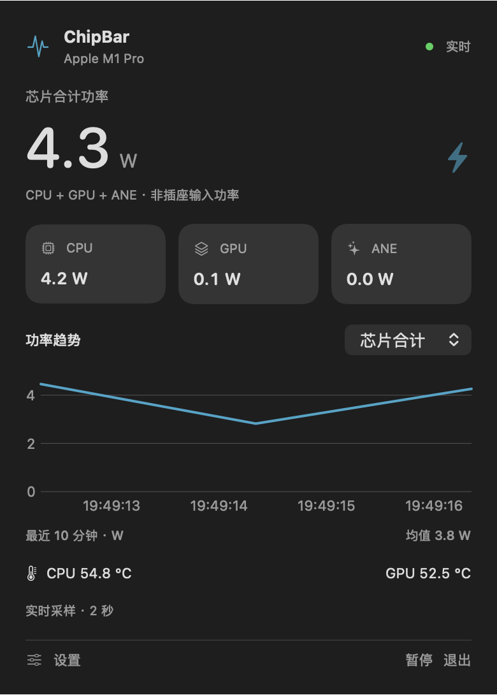
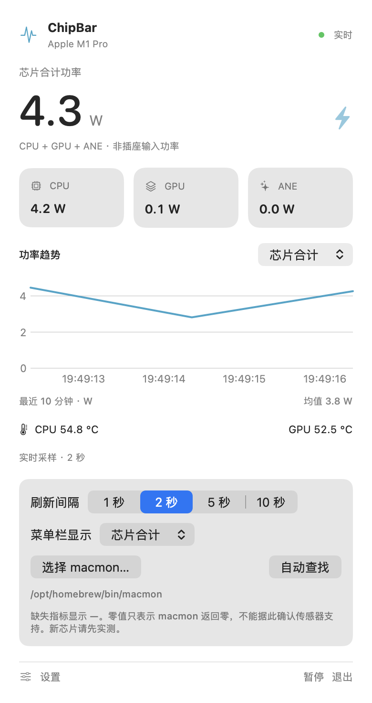

# ChipBar — Native Apple Silicon Monitor

> **Localization:** [English](#features) · [简体中文](#中文说明)  
> **Release target:** v4.0.0 · **macOS 13+** · **Apple Silicon arm64**

ChipBar is a native macOS menu-bar monitor built with SwiftUI and AppKit. It displays real-time CPU and GPU utilization, chip power, per-core CPU activity, memory pressure, fan speed, storage, and USB-C power information. macOS 26+ supports a Liquid Glass panel; older systems use the native material fallback.

> **Distribution notice:** The current published v3.6.6 is ad-hoc signed, not notarized, and still requires a separately installed `macmon`. v4.0.0 migration and notarized bundled distribution are separate work; do not advertise them as completed.

## Screenshots — real application captures

These images are **existing in-repository ChipBar UI captures**, not rendered marketing mockups. They may show an older interface. Updated high-resolution v4.0.0 real-device screenshots must be captured from the actual release build before publishing a v4 product gallery.





## Features

- **Real-time Apple Silicon telemetry:** CPU/GPU usage, chip power, temperatures, CPU cores, fan RPM and memory.
- **Power and peripherals:** USB-C input/output detail, integrated and external storage, optional SMART readings when supported.
- **Widgets:** macOS WidgetKit overview and storage widgets; refresh frequency is controlled by the system.
- **Compute Cluster (read-only):** Discover and mutually pair two Macs; monitor trusted remote hardware and OpenFAST tasks over encrypted LAN telemetry. No remote shell, simulation launch, stop, cancellation, scheduling or computation control is available.
- **Connection clarity:** Separate sharing-disabled, searching, waiting-for-data, offline and online states; stale telemetry must not look live.
- **Privacy:** Core monitoring and retained preferences are local. Cluster observations are shared only after explicit pairing over an authenticated encrypted connection.

## Requirements & installation

- Apple Silicon Mac, macOS Ventura (13) or later.
- For the **currently released version**, install `macmon` separately (for example, `brew install macmon`) and use the [existing v3.6.6 release](https://github.com/wwwwzzzzkkkk/macmon/releases/tag/chipbar-v3.6.6).
- Optional external SSD temperature support requires `smartmontools` and compatible hardware.
- Sensor availability depends on machine model and the upstream metric provider.

## Compute Cluster setup

1. Open ChipBar and the **Compute Cluster** tile on both Macs.
2. Select the discovered Mac and choose **Pair**.
3. Verify the same six-digit pairing code on both machines; approve each side.
4. Once sharing is enabled, the cards show available live telemetry, fan RPM, and OpenFAST task progress **only when observable**.
5. An offline or waiting device is explicitly labeled. Cluster does not execute or control simulations.

More details: [Compute Cluster technical guide](docs/CLUSTER_MONITOR.md).

## Build from source

```bash
cd apps/ChipBar
./scripts/build.sh
open dist/ChipBar.app
```

The current source-tree path applies to the existing monorepo. The standalone repository will use `./scripts/build.sh` at its root. GUI widgets require Xcode, and release signing requires your own Apple signing identity.

## License and credits

ChipBar uses [vladkens/macmon](https://github.com/vladkens/macmon) (MIT) for Apple Silicon metrics. See the repository's MIT license and the bundled third-party licensing notes. ChipBar itself is read-only and does not include simulation orchestration.

---

## 中文说明

**ChipBar** 是使用 SwiftUI 与 AppKit 构建的 Apple Silicon 原生菜单栏监控工具，支持芯片功率、CPU/GPU 占用、逐核心负载、内存压力、风扇转速、磁盘与 USB-C 功率。

**计算集群**：两台 Mac 可以通过局域网发现、双方六位验证码配对并加密共享只读遥测。集群界面明确区分「共享未开启、搜索中、等待数据、离线、在线」。OpenFAST 任务只读取运行情况和可信的日志或外部状态，ChipBar **不会**启动、停止、暂停或调度仿真任务。

**当前发布版本仍是 v3.6.6**，需要独立安装 macmon，采用临时本地签名。v4.0.0 独立仓库和新版本发布尚需完成迁移与发布验证。上方两张为仓库现有的真实界面截图，并非最终 v4.0.0 高清图。

详细使用方法：[集群监控说明](docs/CLUSTER_MONITOR.md)。
