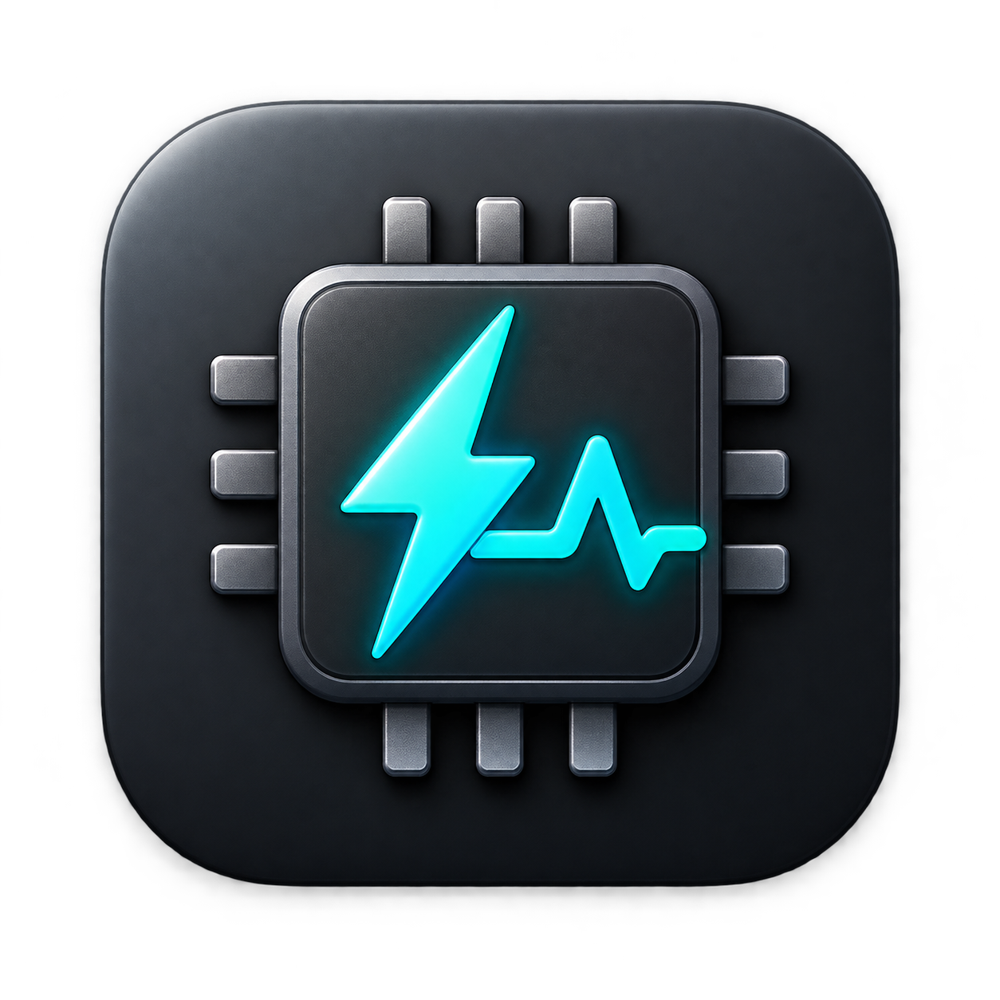
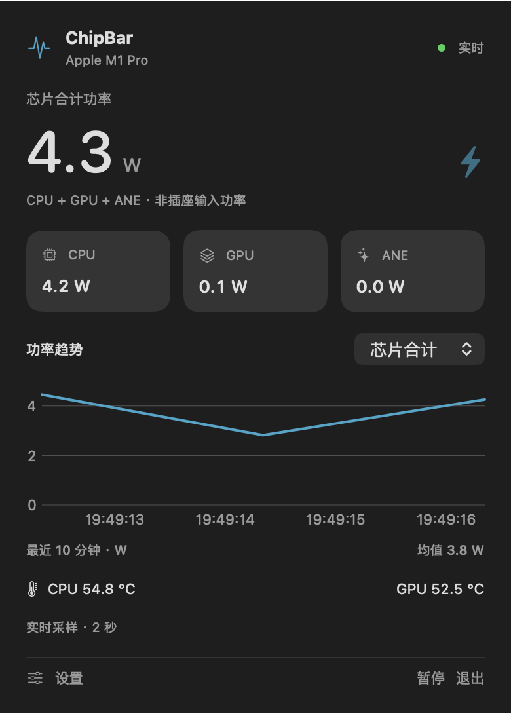
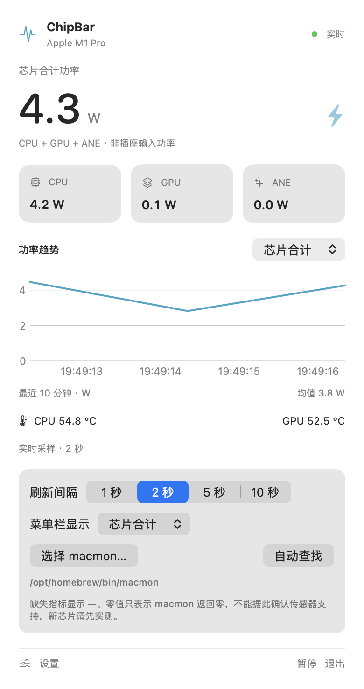

<div align="center">
  

  # ChipBar

  **Apple Silicon 的原生 macOS 菜单栏监控工具**

  一眼查看芯片功率、CPU / GPU 与内存状态、逐核心负载、风扇、应用占用和外接硬盘。

  [](https://github.com/wwwwzzzzkkkk/macmon/releases/tag/chipbar-v3.1.1)
  
  
  

  **[下载 v3.1.1](https://github.com/wwwwzzzzkkkk/macmon/releases/tag/chipbar-v3.1.1)** · **[完整使用说明](apps/ChipBar/README.md)** · **[版本更新记录](apps/ChipBar/CHANGELOG.md)** · **[反馈问题](https://github.com/wwwwzzzzkkkk/macmon/issues)**
</div>

---

## v3.1.1 · 现在的 ChipBar 界面

ChipBar 使用原生 SwiftUI + AppKit 和磁贴式玻璃面板；主面板宽度约 **378 pt**。下方描述来自 v3.1.1 的实际界面结构，而不是旧版设计图。

| 位置 | 最新界面与交互 |
| --- | --- |
| **首页顶部** | 芯片总功率、CPU / GPU / ANE 分项功率、最近约 10 分钟功率趋势 |
| **三个独立圆环磁贴** | 蓝色 CPU、紫色 GPU、薄荷青绿内存；各自显示占用百分比、对应功率或内存容量，以及温度／总容量 |
| **CPU 各核心** | 紧凑柱状图，核类型已确认时在标题旁统一用彩色图例标注，不再逐柱重复缩写 |
| **风扇 + ANE** | 同一行两个等宽磁贴，分别显示 RPM 和 ANE 功率 |
| **储存空间** | 内置 Macintosh HD 容量卡片；已连接的每个外置磁盘各一张可点击卡片，断开时隐藏 |
| **底部入口** | 「电源与功率」直接预览内部功率；「应用占用」打开独立侧边卡片 |
| **设备与设置** | 2 × 2 硬件概览、风扇、采样间隔、八个菜单栏显示项目、菜单栏 SSD 温度总开关、应用更新 |

### 二级卡片：信息不重复

- **电源与功率：** 展示内部系统功率与芯片／其余部件的能量构成，不重复首页 CPU、GPU、ANE 功率或功率曲线。Mac mini 只显示适用的内部功率结构；MacBook 自动区分电池、适配器、充电分流或电池辅助供电。无法可靠读取的值以「—」呈现。
- **应用占用：** 在独立玻璃卡片中切换 CPU、GPU、物理内存、ANE 内存排行，默认最多五个应用；支持合并可识别的辅助进程。
- **外置硬盘：** 点击任意外置卷的主页容量磁贴，查看该卷的容量、同一物理磁盘的温度和型号、读取／写入速率，以及该磁盘的菜单栏温度开关。Macintosh HD 不会跳转到外置硬盘页。
- **设置：** 菜单栏选项以三列磁贴选择，最后的磁盘速率项目占两列；即使没有连接外置硬盘，也可以关闭 SSD 温度的菜单栏总开关。

<details>
<summary>查看仓库保留的旧版界面截图（非 v3.1.1）</summary>

<p align="center">
  
  <br />
  <sub>历史首页截图：仅用于了解产品风格，不代表 v3.1.1 的磁贴排版。</sub>
</p>

<p align="center">
  
  <br />
  <sub>历史设置截图：最新版已经调整设置结构与外置硬盘导航。</sub>
</p>
</details>

## 主要功能

| 分类 | 功能 |
| --- | --- |
| **实时功率** | 芯片总功率、CPU / GPU / ANE 功率、历史曲线；另在电源页提供可读取的内部 DC 功率 |
| **利用率与温度** | CPU / GPU 活跃度、内存占用与内存压力、CPU / GPU 温度、逐核心负载与风扇 RPM |
| **应用资源** | CPU、GPU 驱动时间、Physical Footprint 内存及可用的 ANE 内存记账排行 |
| **网络与磁盘** | 菜单栏网络上下行、磁盘读取／写入速率；首页内部与外接卷空间 |
| **外接 NVMe** | 多磁盘独立详情、型号、可用空间、真实读写速率、可选 SMART 温度与菜单栏温度开关 |
| **自定义与适配** | 八个菜单栏内容项、功率指标选择、采样频率、深浅模式、减少动态效果适配 |
| **性能与隐私** | 可见时按需刷新图表与应用排行；监控和偏好数据留在本机，不提供云同步 |

**读数须知：** 芯片总功率是芯片内部各项读数的合计，不等于整台电脑的插座 AC 功耗。电源页的内部功率取决于机型与 SMC 传感器；「其余部件」是内部功率减去芯片总功率的**估算值**。应用级 ANE 指标是内存记账，**不是** ANE 运算利用率。无法读取时不会填入虚构数值。

## 安装与更新

支持 **Apple Silicon (arm64)、macOS 13 或以上版本**。基础指标来自独立安装的 [macmon](https://github.com/vladkens/macmon)。

**GitHub 安装包：** 进入 **[ChipBar v3.1.1 Release](https://github.com/wwwwzzzzkkkk/macmon/releases/tag/chipbar-v3.1.1)**，下载 `ChipBar-macOS-arm64.zip`；退出旧版，解压并将 `ChipBar.app` 放到「应用程序」。请确认已安装 macmon。

**Homebrew（自动处理 macmon 依赖）：**

```bash
brew tap --custom-remote wwwwzzzzkkkk/chipbar https://github.com/wwwwzzzzkkkk/macmon.git
brew install --cask wwwwzzzzkkkk/chipbar/chipbar
open -a ChipBar
```

更新：

```bash
brew update
brew upgrade --cask wwwwzzzzkkkk/chipbar/chipbar
```

> ChipBar 的发行包采用本地 ad-hoc 签名，**尚未经过 Apple 公证**。如 macOS 阻止打开，请先确认下载来源可信，再依系统提示到「系统设置 → 隐私与安全性」允许。SSD SMART 温度功能另需 `smartmontools` 和硬盘盒的传感器透传支持；没有传感器时仍可使用空间与速率功能。

## 项目与源码

ChipBar 是本仓库 **`chipbar` 分支**下的 SwiftUI / AppKit 原生客户端，位于 **[apps/ChipBar](apps/ChipBar/)**。仓库还保留 Rust macmon 的 `main` 分支；ChipBar 的主要芯片数据来自独立的 [vladkens/macmon](https://github.com/vladkens/macmon)。感谢原作者和贡献者。

**[使用与指标说明](apps/ChipBar/README.md)** · **[外置 SSD 兼容说明](apps/ChipBar/docs/EXTERNAL_SSD.md)** · **[更新记录](apps/ChipBar/CHANGELOG.md)** · **[GitHub Releases](https://github.com/wwwwzzzzkkkk/macmon/releases)**

<details>
<summary>English overview</summary>

**ChipBar v3.1.1** is a native Apple Silicon macOS menu-bar monitor (macOS 13+). Its compact tile dashboard displays CPU, GPU and memory gauges, chip power and trends, CPU-core activity, fans, ANE power and storage. Side panels show app resource rankings, hardware-dependent internal power flow, and per-volume external-drive details. Preferences provide eight menu-bar items and an SSD-temperature master switch that remains accessible when no drive is mounted. Readings depend on hardware and available sensors; the app is not notarized. The existing repository screenshots are historical, not current v3.1.1 captures.

</details>
